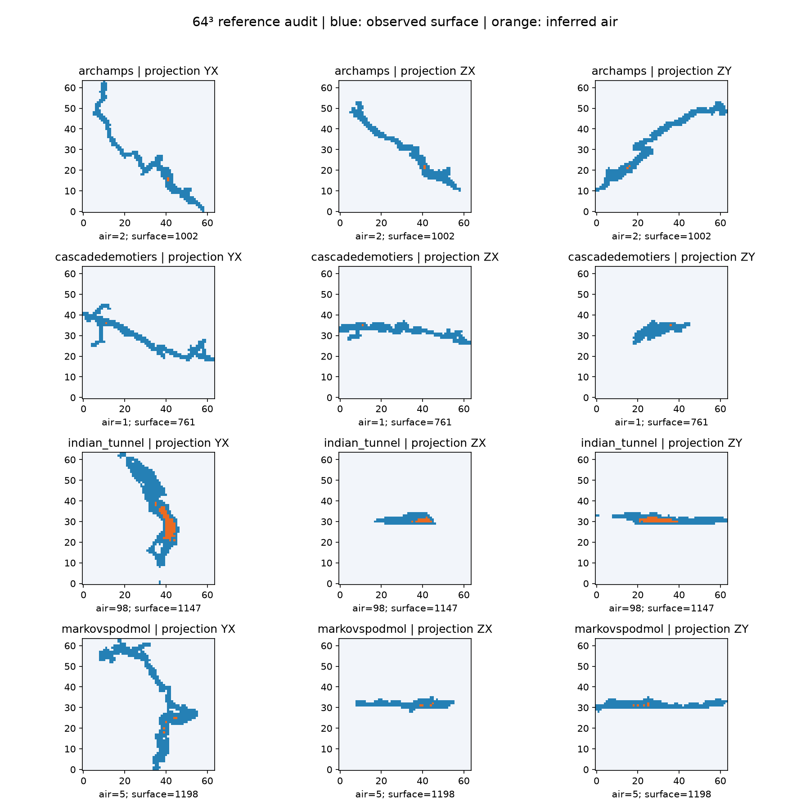

# Auditoria dos voxels de referência para a GAN

Auditoria executada em **15/11/2026**, sem treinamento. Código reprodutível:
[`reference_data.py`](../../../src/cavegen/training/reference_data.py).
O [manifesto completo](reference_audit.json) contém hashes SHA-256 dos nove
NPZ, hashes dos dados binários, metadados, origem, métricas e recibos laterais.
As [partições congeladas](splits.json) usam caminhos relativos, utilizáveis
também no Colab. Nenhum arquivo de referência foi modificado.

## Conclusão da auditoria

**Os interiores disponíveis não são adequados para investigar geração de
cavernas.** São consistentes com o algoritmo de flood fill aplicado às
superfícies, mas praticamente todo o vazio esperado está ausente. Isso é um
problema dos alvos de aprendizado; trocar a função de perda não o resolve.

| Caverna / trecho | Superfície observada | Interior candidato | Ar na grade | Componentes 6 | Maior componente | EDT máxima |
| --- | ---: | ---: | ---: | ---: | ---: | ---: |
| Archamps / PreEtroiture | 1.002 | 2 | 0,000763% | 2 | 1 voxel (50%) | 1,000 |
| Cascade de Môtiers / MainGallery | 761 | 1 | 0,000381% | 1 | 1 voxel (100%) | 1,000 |
| Indian Tunnel / Full 1x | 1.147 | 98 | 0,037384% | 5 | 92 voxels (93,88%) | 1,414 |
| Markov Spodmol / MainGallery | 1.198 | 5 | 0,001907% | 5 | 1 voxel (20%) | 1,000 |

As contagens são de voxels, não de pontos da nuvem. Os quatro interiores têm
shape **64×64×64 = 262.144 voxels**. Bounding boxes do ar em ZYX:
Archamps `2×2×1`, Cascade `1×1×1`, Indian `3×19×10`, Markov `2×8×7`.
Não há interior inteiramente vazio, mas o contrato de degeneração de
`structural-v1` só sinaliza todo-ar/todo-sólido; não basta para detectar esse
problema. Uma componente de um voxel ter fração conectada de 100% não é
evidência de qualidade de uma caverna.

Um controle totalmente sólido acertaria **mais de 99,96%** dos voxels de
qualquer uma dessas referências. Por isso acurácia voxel a voxel, sozinha,
poderia sugerir sucesso para uma saída sem caverna.



Azul = ao menos um voxel de superfície ao longo do eixo projetado;
laranja = ao menos um voxel de ar inferido. A imagem foi inspecionada nos três
planos: revela as superfícies alongadas e o interior residual. A projeção pode
ocultar falhas e sobreposições em profundidade; não certifica um volume fechado.

## O que foi confirmado

- Nove arquivos NPZ binários válidos, com metadados JSON, sem pickle: quatro
  pares superfície/interior em 64³ e a superfície Elaphes em 32³.
- Eixos ZYX; normalização das quatro nuvens por uma escala compartilhada e
  padding simétrico, preservando proporções, sem esticar cada eixo.
- Os quatro interiores têm semântica
  `true_means_enclosed_unobserved_voxel` e estado
  `candidate_requires_geometric_validation`. Não são rótulos de ar validados.
- A reconstrução `classify_surface_by_flood_fill(surface) == INTERIOR`
  reproduz **exatamente** cada interior. A interseção ar/superfície é zero e
  bounds/shapes correspondem entre cada par. Não houve fechamento automático.
- A identidade binária dos quatro interiores é distinta. Superfície e
  interior de uma mesma nuvem são dois produtos da mesma fonte, não duas
  cavernas independentes.
- Os quatro `.run.json` registram processamento concluído, parâmetros,
  fonte e versões históricas. `.command.json` e `.bounds.json` também foram
  preservados no manifesto, com hashes calculados nesta auditoria.
- O vínculo de origem com `origem_nuvens.csv` foi encontrado para os quatro
  pares. A superfície legada Elaphes não tem vínculo automático exato com a
  linha de origem pelo nome do arquivo; sua atribuição geral já existe na
  auditoria anterior. Está excluída do treino de ar por semântica.

## O que não foi confirmado

Os recibos identificam as nuvens por caminho/tamanho/mtime, sem hash integral.
As nuvens originais não foram relidas nesta etapa. Os hashes dos derivados
garantem a identidade do que foi auditado, não a identidade com o download nem
a correção física da reconstrução. Não foi medida cobertura de superfície
contra todos os pontos, nem erro nuvem-malha ou fechamento geométrico.

Não é possível distinguir, só com estes NPZ, quanto da perda resulta de
entradas abertas, lacunas/oclusões, resolução insuficiente ou sua combinação.
As projeções e a EDT são compatíveis com perda severa de espessura; a causa
exata continua uma hipótese a verificar. A cópia local do artigo do
KarstConduitCatalogue é o **preprint de 26/05/2025**, não o PDF final.
O [artigo final, §4.3.2](https://essd.copernicus.org/articles/17/4671/2025/)
também relata regiões sem observação e reconstruções incertas em Markov Spodmol.

As licenças e pendências são as registradas em `origem_nuvens.csv`: há
divergência documental nos produtos do KarstConduitCatalogue e termos
específicos NASA/CMU no Indian Tunnel. Esta auditoria não substitui a
verificação desses termos, nem redistribui nuvens ou PDFs. O ZIP para Colab é
um artefato de trabalho local a ser usado de forma privada.

## Resolução: reduzir não salva estes interiores

Diagnóstico por vizinho mais próximo, com retorno a 64³; não é treino nem
nova voxelização das nuvens. O manifesto inclui métricas e recall/IoU de
reconstrução **do mesmo volume alinhado**. Essa IoU é pertinente à redução de
resolução, não à comparação de duas cavernas geradas sem alinhamento.

| Caverna | Ar em 16³ | Ar em 32³ | Recall do ar após 32³ → 64³ |
| --- | ---: | ---: | ---: |
| Archamps | 0 | 1 | 50,00% |
| Cascade de Môtiers | 0 | 0 | 0,00% |
| Indian Tunnel | 0 | 14 | 74,49% |
| Markov Spodmol | 0 | 0 | 0,00% |

Os quatro desaparecem em 16³. Nearest neighbor pode também alargar um voxel
retido ao voltar a 64³; recall alto não demonstra preservação de geometria.
Os modelos aceitam 16/32/64 para testes de software, mas o dataset de treino
exige resolução nativa correspondente. Não há downsampling silencioso.

A escala compartilhada dos bounds implica aproximadamente 1,849; 4,115;
2,706; 3,919 unidades da nuvem por passo de grade em Archamps, Cascade,
Indian e Markov, respectivamente. Interpretá-las como metros depende das
unidades de origem documentadas no CSV. São resoluções físicas diferentes:
comparar EDT em voxels avalia a forma normalizada, não calibres equivalentes
em metros. É uma razão adicional para estudar trechos/escala física antes de
ampliar o conjunto. Não foi convertido nenhum voxel inferido em uma medida
física de vazio validada.

## Partições e bloqueio de treino

Quatro cavernas independentes com interiores candidatos; quatro folds
rotativos, cada um com duas cavernas para treino, uma para validação e uma
para teste. São **partições de identidade já prontas**, não uma aprovação
geométrica dos dados. O campo `data_status` é
`blocked_insufficient_interior_geometry`. A marca `eligible_proxy` significa
apenas candidato não degenerado reproduzível do flood fill; não significa
pronto para aprender cavernas.

Foi acrescentado um mínimo de engenharia: maior componente com pelo menos
64 voxels e EDT máxima de pelo menos 2 voxels. Nenhum interior atual passa.
São limiares para rejeitar resíduos e espessura mal resolvida; não são valores
publicados como condição suficiente de realismo. A verificação é refeita nos
dados pelo loader, mesmo que alguém altere o sinalizador do manifesto.
`allow_candidate_proxy=True` documenta a aceitação da inferência de ar e não
contorna essa checagem. Passar o mínimo ainda exige inspeção geométrica.

O fold inicial `holdout_indian_tunnel` reserva Markov Spodmol para validação e
Archamps/Cascade para treino. Indian é um tubo de lava; a transferência de
duas cavernas cársticas para ele também envolve mudança de domínio. Relatar
todos os folds separadamente e agregados, sem escolher só o mais favorável.

## Próxima ação com os dados

Foi escolhido um piloto de **recortes por seções transversais sucessivas, com
tampas computacionais nas extremidades**, para inferir o interior de uma
galeria delimitada e preservar seus detalhes. O
[plano detalhado](../../plano-reconstrucao-secoes.md) registra os passos,
as validações e a integração futura com a GAN; o
[resumo simplificado](../../resumo-gargalo-gan.md) explica o problema atual.
Essa escolha é uma proposta a implementar e validar, sem treinamento nesta etapa.

Em 17/11/2026, o [planejamento dos recortes](../../planejamento-recortes-voxelizacao.md)
detalhou a seleção incremental de pontos com contexto, as seções das tampas,
o domínio da grade e o manifesto por trecho. A seleção será feita antes da
voxelização: fornecer bounds menores ao CLI atual não extrai o recorte.

1. Inspecionar cortes das nuvens e/ou malhas oficiais nos gargalos e entradas.
   Confrontar a superfície voxelizada com a nuvem para verificar perda de
   espessura, lacunas e oclusões.
2. Experimentar voxelização mais fina ou trechos com escala física comparável;
   manter o grupo da caverna ao gerar versões e recortes. Aumentar resolução
   sozinho não fecha uma entrada aberta.
3. Reconstruir uma superfície interna com fechamento de entradas explicitado e
   validado, por exemplo a partir de malha apropriada. Registrar regiões
   inferidas e erro nuvem-malha. Não aplicar dilatação arbitrária aos quatro
   interiores atuais para transformá-los em alvos de cavernas.
4. Gerar novos NPZ, repetir a auditoria e congelar novos hashes/partições.
   Inspecionar a geometria antes de habilitar treino. A arquitetura 64³ só é
   pertinente se o vazio for resolvido nessa escala; caso contrário usar
   recortes válidos ou revisar a resolução/arquitetura.

```powershell
$env:PYTHONPATH='src'
.\.venv-gan\Scripts\python.exe -m cavegen.training.reference_data
.\.venv-gan\Scripts\python.exe -m cavegen.training.plot_reference_audit
```

O ambiente `.venv` existente aponta para Linux e não executa no Windows.
A verificação do ambiente persistente de documentos também falhou: não existe
a distribuição WSL Ubuntu nem o caminho `/home/midnavi/...` nesta máquina.
Foi criado `.venv-gan`, ignorado pelo Git, usando Python 3.12; a extração dos
PDFs usou `pypdf` nesse ambiente disponível, sem reinstalar/modificar o
ambiente persistente ausente. O inventário dos artigos consultados está em
[`papers.json`](papers.json). Textos extraídos ficam apenas em `tmp/`, ignorado.
