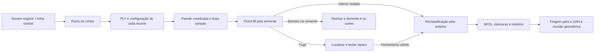

# Preparação e voxelização das cavernas de referência para a GAN

**Relatório técnico do TCC · 26 de novembro de 2026**

Em 27/11, o piloto passou a usar `holdout_carste`, com 52 recortes a
16 cm. As contagens históricas deste relatório descrevem os ensaios
anteriores à atualização. [Inventário ativo](../../relatorios/inventario-gan-holdout-carste.md) ·
[Vallorbe e novo fold](historico-voxelizacao.md#vallorbe-e-novo-fold-cárstico)

## Resumo executivo

O trabalho prepara volumes de galerias reais para treinar e avaliar uma GAN
de geração procedural. A primeira abordagem encaixava cada levantamento
inteiro em 64³. O flood fill era reproduzível, porém quase todo o vazio
esperado desaparecia da grade. A preparação passou a trabalhar com
**recortes pela linha central e voxels de tamanho físico fixo**. Cada
recorte guarda a origem das coordenadas, os pontos observados, as
barreiras usadas no fechamento e o ar que o algoritmo conseguiu isolar.

Os seis recortes do piloto de Archamps PostEtroiture fecharam a 16 cm e
passaram na reprodução independente. Três precisaram de reparo local, dois
de tampas auxiliares sintéticas e um fechou apenas com as tampas de
extremidade. Nos outros levantamentos, o trabalho avançou com revisão de
cortes, reextração da nuvem, recuperação de paredes, uso de malhas e busca
de trechos que coubessem na grade sem alterar a escala. Essas intervenções
têm evidências e limites diferentes, detalhados abaixo.

O manifesto experimental a **16 cm** contém **35 volumes cúbicos** que
passaram na triagem numérica nas quatro cavernas. O Indian Tunnel tem
apenas um trecho nessa seleção. Os cinco levantamentos selecionados têm
uma rasterização integral da superfície a 16 cm. A reconstrução de
interiores continua parcial, a revisão geométrica segue pendente e o
treinamento da GAN permanece por executar. Os arquivos a **28 cm** compõem
um ensaio separado de sensibilidade à resolução.

## 1. O problema que a voxelização precisa resolver

Uma nuvem de pontos registra as superfícies alcançadas pelo levantamento.
Entre pontos podem existir lacunas de medição, oclusões e aberturas reais.
Uma célula sem pontos pode corresponder a ar interno, exterior ou região
sem observação. Para produzir uma referência de interior, é preciso
delimitar uma galeria e demonstrar que a região que contém sua semente
fica isolada do exterior na grade.

No ensaio global em 64³, os interiores tinham somente **2, 1, 98 e 5
voxels** em Archamps PreEtroiture, Cascade de Môtiers, Indian Tunnel e
Markov Spodmol, respectivamente. Uma grade inteira tem 262.144 células.
Esses resíduos davam mais de 99,96% de acerto a uma previsão inteiramente
sólida, pela métrica de acurácia por célula. O problema estava no alvo
de aprendizado. A escala física também variava entre cavernas nessa
normalização global com preservação de proporções.

Na abordagem atual, uma grade 64³ a 16 cm tem **10,24 m por lado**
incluindo as margens. Um recorte que excede a caixa permanece na sua
grade nativa. O tamanho físico de um voxel é comum a todos os recortes
da mesma condição experimental. [Auditoria dos volumes globais](README.md#conclusão-da-auditoria)

## 2. Levantamentos e partições

| Caverna | Levantamento usado | Linha central para os lotes | Papel no fold inicial |
| --- | --- | --- | --- |
| Archamps | PostEtroiture LAS de 2 mm e PreEtroiture LAS de 5 cm | Grafos dos levantamentos | Treino |
| Cascade de Môtiers | MainGallery LAS de 5 cm | Grafo fornecido | Treino |
| Markov Spodmol | MainGallery LAS de 5 cm | Grafo fornecido | Validação |
| Indian Tunnel | Full F32, com ensaios nas variantes 10x e 1x e nas nuvens Section1 e Section2 | Grafo estimado na 10x e reutilizado na comparação com a 1x | Teste |

O fold inicial é `holdout_indian_tunnel`. A unidade independente é a
caverna. PreEtroiture e PostEtroiture ficam juntos, assim como versões de
densidade, escala e corte da mesma caverna. A auditoria também prepara
quatro folds rotativos com o mesmo princípio. Os 35 candidatos a 16 cm
representam **quatro cavernas**, com trechos correlacionados em cada uma.

## 3. Como se produz um volume

1. **Planejar pela linha central.** O grafo descreve o percurso das
   galerias. O planejador divide as cadeias entre extremidades e
   bifurcações, prioriza trechos mais longos quando há limite de recortes
   e evita colocar o plano no próprio nó da junção. Projeta os pontos
   nas arestas candidatas e filtra por ramo, estação, distância ao eixo e
   planos de extremidade. A proximidade de outra passagem ou de um retorno
   do próprio ramo gera alerta.
2. **Ajustar as duas extremidades.** Uma estação é uma distância ao longo
   da linha central. Perto de cada estação, os pontos são projetados no
   plano transversal. O ajuste radial usa o percentil 75 dos raios em cada
   setor angular, com margem de meio voxel. Quando adotado, o modo
   `connected` separa aglomerados antes de ajustar o contorno. Ele exige
   um único componente com pelo menos 14 de 16 setores sustentados e
   lacunas angulares isoladas. A configuração deixa a tampa pendente se a
   evidência for insuficiente ou se dois componentes forem aptos.
   Os vizinhos compartilham a geometria do corte, com normais opostas.
3. **Extrair e rasterizar.** O PLY conserva as coordenadas locais dos
   pontos retidos e a configuração preserva a origem do levantamento.
   É preciso reextrair da nuvem original para recuperar pontos excluídos
   por um limite anterior. As células são armazenadas em ordem **ZYX**.
   A grade precisa ter margem livre ao redor da barreira e cada tampa
   precisa tocar a parede voxelizada. Os HTMLs Plotly permitem revisar
   contornos, semente e camadas antes e depois do flood fill.
4. **Inundar a partir da semente.** O algoritmo percorre posições livres
   por vizinhança de face, com seis vizinhos. Se a semente está na
   barreira, a revisão começa por sua posição e pela camada que a ocupa.
   Se a componente alcança a borda da caixa, existe uma rota de fuga.
   Quando fica isolada, a componente é uma candidata a ar interno.
5. **Conferir pelo caminho inverso.** A rotina de auditoria parte da
   borda, identifica o exterior e compara a componente da semente com o
   ar publicado. A triagem de entrada na GAN também verifica se o
   interior toca as duas tampas. Os relatórios registram o resultado
   das retiradas dos reparos e das tampas aplicáveis.

O **percentil 75** diz respeito ao raio em cada setor da tampa. Escolher
ou mover uma estação ao longo da galeria é outra operação. Para um
corte interno, todo deslocamento de estação precisa ser aplicado aos
dois recortes e seguido pela reextração de seus PLYs.
[Planejamento dos recortes](../../planejamento-recortes-voxelizacao.md)

| Camada na saída | Como interpretar |
| --- | --- |
| `surface.npz` | Superfície rasterizada. No fluxo padrão vem dos pontos. Nos ensaios que aplicam malha, as máscaras auxiliares identificam as contribuições da malha e da nuvem. |
| `caps` em `masks.npz` | Duas barreiras desenhadas nos planos de corte. |
| `repair` em `masks.npz` | Células acrescentadas pelo reparo local dos caminhos de fuga. |
| `auxiliary_caps` em `masks.npz` | Barreiras sintéticas propostas após o reparo local. |
| `interior.npz` | Componente de ar inferida a partir da semente e verificada pelo exterior. |

A estimação da linha central é reutilizável em `cavegen.tools`, com a
mesma base na `main` e na branch neural. A Datastream cuida do plano,
do recorte e dos arquivos. A revisão visual usa Plotly e o foco
experimental permanece na geometria e nos algoritmos de geração.
[Ferramenta de linha central](../../../src/cavegen/tools/centreline.py)

## 4. Como cada conserto é aplicado

| Falha observada | Procedimento | Evidência usada para aceitar |
| --- | --- | --- |
| Contorno ausente ou alongado | Voltar à nuvem original. Testar um componente conectado, recentrar o ajuste no próprio plano ou deslocar a estação. Reutilizar o mesmo corte nos vizinhos. | Suporte angular, coerência do contorno e inspeção do corte comum no Plotly. |
| Semente bloqueada | Revisar os pontos e as fatias. Propor uma semente em ar interno do mesmo trecho. Em lote, procurar um componente que alcance as duas tampas e fique próximo do eixo. | Semente livre, interior do trecho correto e fechamento reproduzível. |
| Fuga localizada | Testar planos completos nas extremidades. Varrer janelas de oito voxels com avanço de quatro e refinar bordas em passos de um voxel. Rastrear a fuga e comparar os bins do PLY com os da fonte original. | Um conjunto de até 12 células nas rotas de fuga, sustentadas por pontos da fonte dentro da seleção ou continuidade local da parede. O recorte inteiro deve fechar preservando as sementes das janelas já seladas. |
| Fuga persistente em passagem sem ambiguidade registrada | Se autorizado no `crop.json`, tentar tampas sintéticas auxiliares, depois do reparo local. | Menor raio aceito, ar isolado tocando as duas extremidades, sementes internas preservadas e classificação exterior reproduzida. |
| Fuga perto de outra passagem ou junção | Conferir a rota e as linhas centrais próximas. Testar suporte medido da parede, outro recorte ou uma delimitação explícita por cada saída da junção. | Verificação da pertença dos pontos e dos ramos alcançados. A geometria de possíveis aberturas reais exige inspeção. |

### Tampas sintéticas auxiliares

As **tampas de extremidade** definem onde começa e termina o recorte.
As **tampas auxiliares** são células acrescentadas para reparar fugas
persistentes da barreira formada pela parede e pelas extremidades. O
parâmetro `auxiliary_cap_radius_voxels` habilita o ensaio e limita seu
raio. O valor padrão é zero. No piloto a 16 cm, o máximo foi quatro
voxels, ou 0,64 m de raio morfológico.

O código testa raios crescentes. Ele dilata a barreira, erode o resultado
com o mesmo raio e preenche as cavidades da máscara temporária. Da
envoltória obtida, seleciona as células que faltavam na barreira
original. Em seguida verifica a componente da semente. Só conserva as
células novas que fazem fronteira com essa componente, quando ela está
isolada e alcança as duas tampas. As sementes das janelas previamente
fechadas precisam continuar nessa componente. O raio descreve a busca
morfológica na grade. A medida física de uma abertura exigiria inspeção
da nuvem.

A máscara `auxiliary_caps` preserva a hipótese, separada da parede
medida, de `caps` e de `repair`. A inspeção Plotly mostra a camada
auxiliar em vermelho. É possível medir o quanto os resultados dependem
dessa hipótese e retomar a avaliação de uma eventual continuação da
galeria. [Implementação das tampas auxiliares](../../../src/cavegen/tools/flood_fill/auxiliary_caps.py)

## 5. Archamps, do primeiro erro ao fechamento do piloto

- **Tampa inicial do 001, a 0,16 m.** A inspeção mostrou que um aglomerado
  mais distante puxava o contorno para uma extensão lateral. Na quarta
  faixa angular, a parede principal ocupava aproximadamente 1,20–1,50 m
  de raio e outro grupo aparecia além de 2,80 m. O percentil 75 atingia
  esse segundo grupo e a tampa chegava a 3,22 m naquela faixa. A correção
  preservou a estação e ajustou o contorno pelo componente conectado
  sustentado pelos pontos.
- **Corte 001/002.** A estação original a 8,76 m tinha quatro faixas
  consecutivas vazias até na consulta ao LAS. Uma nova estação a 9,24 m
  recuperou a cobertura angular.
- **Corte 005/006.** Na estação original a 42,34 m, havia pontos em quatro
  setores pendentes, todos dentro do raio mínimo de 16 cm. O deslocamento
  para 43,62 m recuperou o suporte. A amostra efetiva do plano revisado
  usou 15 de 16 setores e produziu o mesmo contorno nos dois recortes.
  No lote seguinte os dois ainda vazaram. A rota principal do 005 ficou
  entre os planos e chegou à borda inferior da grade. A do 006 cruzou
  o plano da extremidade final a 50,62 m. Naquela tentativa, ambas as
  rotas ficaram do seu lado do corte compartilhado.
- **Semente do 001.** Depois do ajuste das tampas, ainda caía na parede
  observada. Foi substituída pelo ponto local XYZ
  `[35.0406, 27.8859, -6.191]`, na estação de aproximadamente 3,898 m.
  Três células de reparo local foram suficientes na nova execução.

| Recorte | Grade nativa ZYX | Reparo local | Tampa auxiliar | Raio usado | Ar candidato |
| --- | --- | ---: | ---: | ---: | ---: |
| 001 | 64×78×64 | 3 | 0 | — | 6.659 |
| 002 | 64³ | 2 | 0 | — | 9.893 |
| 003 | 64³ | 2 | 0 | — | 7.490 |
| 004 | 64³ | 0 | 0 | — | 8.139 |
| 005 | 64×64×68 | 0 | 69 | 2 voxels | 12.455 |
| 006 | 64³ | 0 | 46 | 4 voxels | 8.022 |

Em 005, a extensão em X do recorte com sua margem pediu 68 células.
Preservar essa dimensão mantém os voxels de 16 cm e a geometria
selecionada. Todas as máscaras de ar foram reproduzidas. A retirada
das tampas auxiliares reabriu 005 e 006, que continuam com indicação
de revisão geométrica. Os artefatos estão no plano
`piloto_2mm_6_trechos_revisao_tampas`.
[Registro detalhado do piloto](../../plano-reconstrucao-secoes.md#evolução-do-piloto-em-archamps)

## 6. Extensão para os outros levantamentos

### Planos iniciais e revistos a 16 cm

| Levantamento | Recortes por plano | Fecharam no primeiro plano | Fecharam após revisão |
| --- | ---: | ---: | ---: |
| Cascade de Môtiers, MainGallery 5 cm | 63 | 12 | 14 |
| Markov Spodmol, MainGallery 5 cm | 65 | 10 | 11 |
| Indian Tunnel, Full 10x | 32 | 1 | 2 |
| Indian Tunnel, Full 1x | 32 | 1 | — |

Em Cascade, os **63 recortes** foram escolhidos para seções de cerca
de 8 m nas passagens mais longas. O grafo da MainGallery tem **24 nós de
bifurcação e 49 cadeias**. O primeiro plano priorizou 19 dessas cadeias
e cobriu cerca de 410 m ao longo do grafo. A seleção complementar
aumentou a cobertura planejada para 33 cadeias. No plano revisado,
os 14 recortes que fecharam somam aproximadamente 108,2 m de linha
central. Esse comprimento e a quantidade de ramos fechados são
indicadores diferentes da cobertura da nuvem completa.

A revisão identificou **27 fugas em Cascade com alerta de passagem
próxima ou retorno**. Todas persistiram mesmo com os planos de
extremidade cobertos temporariamente. Mover ou refazer os contornos
ajuda quando o bloqueio está na seção. Para essas fugas, a investigação
precisa seguir a rota em três dimensões e avaliar junções ou
continuações possíveis. Um plano complementar testou também ramos
omitidos em Markov e Indian Tunnel. Ramos curtos demais segundo o
limite atual ficaram registrados em `cobertura.json` para tratamento
posterior. [Contagens, estações e ramos](historico-voxelizacao.md#ramos-omitidos-no-primeiro-planejamento)

### Ensaios de recuperação

| Ensaio | O que se alterou | Resultado confirmado |
| --- | --- | --- |
| Recentrar o contorno | Usar pontos dos PLYs vizinhos para ajustar o centro dentro do mesmo plano. | Recuperou 11/19 contornos testados em Cascade e 4/18 em Markov. Fecharam mais dois recortes em Cascade e um em Markov. Os 26 contornos de Indian seguiram pendentes nessa rodada. |
| Reextrair com busca ampliada | Consultar a fonte até 2,56 m antes ou depois do corte, testar recentragem de até 0,96 m e refazer os PLYs afetados. | Obteve contornos para 19/19 cortes de Cascade, 12/18 de Markov e 2/26 de Indian. Os dois fechamentos foram novas versões de trechos já recuperados. |
| Repor células com pontos do mesmo ramo | Exigir dois pontos da nuvem por célula e confirmar a atribuição ao ramo e intervalo. | Em 61 casos ambíguos investigados, 17 tinham células com esse apoio e nenhum recorte fechou. |
| Consultar mais pontos dentro do recorte | Remover o filtro de ramo para recuperar células com pelo menos dois pontos medidos e checar se o ar passa por outros eixos. | Em Cascade, o `ramo_035_009` fechou em 64³ com 235 pontos originais acrescentados em 35 células. O interior reproduzido tem 14.304 voxels. |
| Rever sementes e junções | Buscar componente interno entre as tampas em 14 casos de semente bloqueada. Testar também junções com uma tampa por saída e a remoção de um corte intermediário. | A busca de sementes ficou sem componente elegível. Entre 11 junções com todas as tampas, dez vazaram e uma teve a semente bloqueada. O intervalo combinado ensaiado em Markov também vazou. |
| Usar malhas derivadas do levantamento | Rasterizar os triângulos na mesma grade e guardar a contribuição separadamente. Em outro ensaio, recuperar tampas na interseção dos triângulos com o plano. | Seis fechamentos com apoio de malha passaram na reprodução do flood fill. O candidato `ramo_017_002` de Cascade reabriu ao restringir as células de malha às que estavam a até 96 cm da nuvem. |
| Acrescentar Section1 e Section2 em Indian | Combinar amostras das nuvens parciais com a Full 10x, mantendo caixa e planos. | Os oito recortes testados continuaram vazando. |

A malha PreEtroiture exigiu um alinhamento de **+100 m em X** em
relação ao LAS. Após a transformação, a distância amostral entre
malha e pontos teve percentil 95 de aproximadamente 4 cm, registrado
em `alinhamento.json`. Os ensaios preservam a origem da malha, as
células que ela acrescentou e a sensibilidade do interior a essa
contribuição. [Histórico dos ensaios com malhas](historico-voxelizacao.md#apoio-das-malhas-e-dos-arquivos-seccionais)

### Indian Tunnel, perfis transversais e rotação

O levantamento Full 1x completo tem amplitude medida de
**76,46 m em X, 170,45 m em Y e 15,43 m em Z**. Essas dimensões são a
diferença entre o mínimo e o máximo das coordenadas, incluindo toda
a nuvem. A soma dos ramos do grafo estimado é cerca de **188 m**. O
plano principal contém **32 recortes**, e as **269 estações** foram
fatias diagnósticas ao longo do grafo, em passos de **0,64 m**.
[Limites da Full 1x](../../../data/processed/experiments/superficies_16cm/indian_tunnel/Full/resumo.json) ·
[Estações avaliadas](../../../data/processed/experiments/secoes_indian_16cm/faixa_064_raio_2/estacoes.csv)

Em cada estação, os pontos foram projetados numa grade transversal de
16 cm. Foram testadas faixas com semiespessuras de 16, 32, 48 e 64 cm,
com fechamento morfológico de um ou dois voxels. No ensaio com
64 cm de cada lado, três estações consecutivas do ramo 002
sustentaram um intervalo de **33,12 a 34,40 m** no grafo. As duas
primeiras fecharam com os pontos medidos, e a terceira precisou
do fechamento de dois voxels na seção. Os pontos originais desse
intervalo foram reextraídos e o recorte em 3D fechou a 16 cm.

| Versão do mesmo trecho | Grade nativa | Ar candidato | Células de tampa auxiliar |
| --- | --- | ---: | ---: |
| Antes da rotação | 66×64×81 | 20.713 | 39 |
| Rotação horizontal de cerca de 21,6° | 64³ | 20.433 | 46 |

A rotação foi aplicada aos pontos, planos e linha central antes de
voxelizar novamente. Preservou a escala e o eixo vertical. O recorte
girado passou no flood fill independente e na checagem de que o ar
deixava fora os eixos dos outros ramos no domínio analisado. As versões
tiveram IoU física de aproximadamente **0,879**, estimada com 64
amostras por voxel. O cálculo divide a interseção física dos volumes
pela união no mesmo sistema de coordenadas. A comparação dá uma
medida da sensibilidade à rasterização. O trecho de **1,28 m no eixo**
ainda representa uma parcela pequena do levantamento.
[Histórico da varredura e da rotação](historico-voxelizacao.md#perfis-transversais-e-rotação-horizontal-no-indian-tunnel)

## 7. Superfície completa e interiores candidatos

Os cinco levantamentos abaixo foram rasterizados integralmente numa grade
esparsa a 16 cm. A leitura conferiu a contagem de pontos da fonte. O NPZ
armazena os índices ZYX das células com observação e quantos pontos
caíram em cada uma. Uma célula ausente tem ocupação desconhecida.
Esta representação preserva a evidência medida dos ramos e trechos
que continuam sem interior reconstruído.

| Levantamento | Pontos lidos | Células com pontos | Grade esparsa ZYX |
| --- | ---: | ---: | --- |
| Archamps PostEtroiture | 136.051.177 | 45.989 | 96×251×284 |
| Archamps PreEtroiture | 824.296 | 144.503 | 490×727×618 |
| Cascade de Môtiers MainGallery | 3.592.310 | 593.842 | 267×710×1621 |
| Markov Spodmol MainGallery | 5.553.445 | 872.604 | 171×1543×1159 |
| Indian Tunnel Full 1x | 116.205.392 | 305.895 | 97×1067×479 |

Os pares `superficie_esparsa.npz` e `resumo.json` ficam localmente
em `data/processed/experiments/superficies_16cm/`. O resumo registra
a origem da grade, a ordem dos eixos, os limites da nuvem e a
identificação da fonte. Essas superfícies têm semântica de observação
e ficam fora dos manifestos de ar.

## 8. Estado da preparação para a GAN

| Condição | Lado da grade | Volumes auditados | Passaram na triagem em 64³ | Treino / Validação / Teste no fold inicial |
| --- | ---: | ---: | ---: | --- |
| 16 cm por voxel | 10,24 m | 45 | 35 | 26 / 8 / 1 |
| 28 cm por voxel | 17,92 m | 36 | 34 | 19 / 13 / 2 |

A seleção de 16 cm tem **9** volumes de Archamps, **17** de Cascade,
**8** de Markov e **1** de Indian Tunnel. Para passar na triagem, o
volume precisa ter escala e grade cúbica nativas da condição, interior
reproduzível em contato com as duas tampas, componente de ar com no
mínimo 64 voxels e distância máxima à barreira de pelo menos dois
voxels, medida pela transformada de distância euclidiana. Esses
limites descartam resíduos pequenos ou muito finos. A fidelidade
da forma e a cobertura continuam sujeitas a revisão.

O ensaio a 28 cm rasterizou os mesmos PLYs do ensaio comparável e
manteve as posições de corte. A maior caixa física permitiu acomodar
trechos de Indian Tunnel que excediam 64³ a 16 cm. Nesses dois
volumes comparáveis, a IoU física entre resoluções foi de cerca de
0,91. Em alguns trechos de Cascade e Markov ficou abaixo de 0,65.
Mudar a escala altera o detalhe da parede e pode mudar por onde o
flood fill passa. A resolução definitiva segue em avaliação.

As auditorias registram hashes dos interiores, das superfícies e das
máscaras. Os quatro folds de cada condição passaram na checagem de
integridade e separação por caverna. O estado experimental dos
manifestos é `gallery_proxy_pending_review`. O carregador exige o
aceite explícito de ar candidato por `allow_candidate_proxy=True`.
As duas condições devem ser analisadas separadamente, inclusive
quando representam o mesmo intervalo da mesma caverna.
[Rotina de auditoria](../../../src/cavegen/training/gallery_reference_data.py)

Os manifestos e os relatórios de auditoria abaixo apontam para os
artefatos locais do repositório.
[Partições a 16 cm](../../../data/processed/experiments/gan_piloto_16cm/splits.json) ·
[Auditoria a 16 cm](../../../data/processed/experiments/gan_piloto_16cm/reference_audit.json) ·
[Partições a 28 cm](../../../data/processed/experiments/gan_piloto_28cm/splits.json) ·
[Auditoria a 28 cm](../../../data/processed/experiments/gan_piloto_28cm/reference_audit.json)

## 9. Onde verificar e reproduzir um recorte

Na raiz, execute `.venv/bin/python -m cavegen.datastream` e entre em
**Preparar recortes por galeria**. Use **5** para gerar o plano e os
PLYs e **6** para conferir os contornos no Plotly. Em **3 — Voxelizar
recortes**, a opção **1** recebe o `crop.json` para um recorte. A opção
**2** recebe a pasta do plano ou seu `plan.json` para processar as
subpastas. O console mostra qual recorte está em execução e as
contagens de pontos. A opção **4** abre resultados e diagnósticos.
[Guia operacional da Datastream](../../preparacao-volumes.md)

| Artefato local | Uso na revisão |
| --- | --- |
| `data/processed/crop_plans/` | `plan.json` por plano e `crop.json` com `cloud.ply` em cada recorte. Verificar fonte, estação, contorno, semente, escala e alertas. |
| `data/processed/reference_sections/` | `lote.csv`, quando produzido em lote, e registros por recorte. Cada resolução publicada contém `surface.npz`, `masks.npz`, `interior.npz` e `run.json`. |
| `<resolucao>/relatorio_volume/` | Evidência de um volume publicado. `summary.csv` descreve o método e as contagens. `checks_replay.csv` guarda a reprodução independente quando executada. |
| `<resolucao>_sem_volume/<tentativa>/` | Evidência de uma tentativa interrompida sem volume. `summary.csv` aponta o estágio. `probes.csv`, `paths.csv` e `bins.csv` localizam a falha quando houve diagnóstico de fuga. |
| `data/processed/experiments/gan_piloto_16cm/` e `gan_piloto_28cm/` | `reference_audit.json` com evidência, métricas e motivos de exclusão da triagem. `splits.json` com as partições por caverna. |

O nome `relatorio_volume` fica dentro de uma grade publicada. O
sufixo `_sem_volume` indica o histórico de tentativas ao lado dela.
A opção 4 também reconhece `diagnostics` dentro dos volumes e os
sufixos antigos `.diagnostics` e `_tentativas_sem_volume` nas
tentativas. Para refazer a
classificação a partir dos NPZs, passe o caminho da resolução a
`.venv/bin/python -m cavegen.datastream.gallery_reports`. Isso atualiza
o `checks_replay.csv` sem reler a nuvem. Os dados brutos e derivados
locais são necessários para seguir os caminhos dos manifestos.

As tampas sintéticas e a organização dos nomes têm registros separados
no histórico Git. O commit `87e3479` introduziu as tampas auxiliares,
o processamento em lote e a auditoria do piloto. O commit `9242c1d`
encurtou os nomes e diferenciou relatórios de volumes publicados do
histórico de tentativas. O restante das rodadas e seus resultados por
recorte tem registro próprio.
[Histórico da voxelização](historico-voxelizacao.md)

## 10. O que falta decidir e verificar

1. **Cobertura por caverna.** Levantar os intervalos já recuperados e
   os que continuam abertos, incluindo ramos curtos e junções.
   Os recortes pendentes, as tentativas e os registros de superfície
   são preservados para retomar o processamento. Em Indian Tunnel,
   a prioridade é ampliar a cobertura de interiores verificáveis
   além do único trecho que passou a 16 cm.
2. **Tratamento de aberturas incertas.** Revisar as tampas auxiliares
   do 005 e 006 e os casos com passagens muito próximas. Registrar a
   evidência em cada abertura e testar a sensibilidade das métricas
   com e sem os fechamentos que puderem ser isolados. Em regiões com
   apoios de malha, medir a dependência das células inferidas.
3. **Escala e grade final.** Comparar resultados físicos nos mesmos
   recortes antes de decidir a escala de treino. A triagem de
   rotação horizontal apontou seis outros recortes com caixa
   potencialmente compatível. As tentativas exploratórias de
   revoxelização tiveram interrupções de execução ou validação
   de configuração. O manifesto usa apenas as versões já auditadas.
4. **Validação do conjunto.** Congelar o manifesto somente após
   revisar a geometria, a representatividade e a dependência de
   fechamentos. Manter o agrupamento por caverna. Relatar a cobertura
   e a distribuição de calibres, comprimentos e formas que a GAN
   terá como referência, inclusive as limitações do conjunto de teste.
